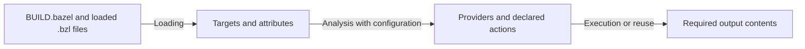

# Choose the build phase and graph relevant to a task

Use this page to decide whether a problem concerns target declarations,
configuration and analysis, or execution. Read [labels and targets](labels-and-targets.md)
first if these terms are unfamiliar.

## Follow the three conceptual phases

| Phase | What happens | What to inspect |
| --- | --- | --- |
| Loading | Bazel evaluates needed build files and their loaded `.bzl` files; rule calls instantiate targets. | Target names, attributes, dependency labels, loaded symbols. |
| Analysis | Rule implementations evaluate configured targets, expose providers, and register actions with declared inputs and outputs. | Attribute values, dependency providers, configurations, action definitions. |
| Execution | Bazel obtains the required action outputs, running actions when needed; test execution also belongs here. | Produced contents and execution failures. |

These are the [documented evaluation phases][phases]. A rule implementation runs
during analysis: registering an action does not execute its command or read its
generated output. Generated contents become available through execution.
[Rule implementation and File semantics][rules]

The diagram is a conceptual model, not a claim that every invocation recomputes
every phase. Bazel selects the work needed for requested outputs; registered
actions with unneeded outputs need not run. Existing outputs or configured cache
results can also avoid action execution. [Demand-driven work][phases],
[output reuse][cache]

## Distinguish the graphs

The **target graph** describes the targets and dependency relationships loaded
from build files. It precedes configuration selection. The **configured target
graph** contains analysis results under particular configurations; one target
label can occur in more than one configuration in the same build.
[Query graph][query], [configured targets][cquery]

The **action graph** describes registered actions, their input and output
artifacts, and the relationships connecting that work. Its nodes are not a
one-to-one list of rule targets. Use it to inspect the work a rule registered.
[Action graph inspection][aquery], [rule actions][rules]

## Pick the query for the question

| Question | Tool | Boundary |
| --- | --- | --- |
| Which targets are declared or reachable? | `query` | Uses the post-loading target graph; includes possible `select()` branches rather than resolving them. [Source][query] |
| Which dependencies or outputs apply under these build options? | `cquery` | Uses analysis results and configurations. A label may match multiple configured instances. [Source][cquery] |
| Which actions, inputs, outputs, and command lines were registered? | `aquery` | Exposes the post-analysis action graph; it is not evidence that a command executed successfully. [Source][aquery] |

Our recommendation: diagnose at the earliest phase that explains the symptom.
For a configured-dependency question, use the same relevant build options as the
failing build. For a produced-content problem, inspect both the action definition
and the execution result. Query output alone is not the success criterion.

## Trace the fixture

Read [BUILD.bazel](../examples/foundations/BUILD.bazel) and
[defs.bzl](../examples/foundations/defs.bzl) together. Loading declares
`//:greeting` and its consumer `//:report`. Analysis passes the generated message
artifact through `GreetingInfo` and registers the template-expansion actions.
Execution produces the report's contents. These are statements about this
fixture, not a requirement that every rule use a template or custom provider.

The [verification record](../verification/foundations.md) supplies exact commands
and results for `query`, `cquery`, `aquery`, and `build`. It also records an
intentional provider-validation failure. Use that record to reproduce the
example with controlled rc loading and the documented trust configuration.

## Boundaries and next task

The fixture does not exercise conditional dependencies, multiple configurations
of one label, remote execution, or remote cache reuse. Those explanations are
source-verified only. See the [claim record](../verification/core-labels-phases.md).

Continue with the [rule contract](rule-contract.md) when implementing a rule.

[phases]: https://github.com/bazelbuild/bazel/blob/fee2bf2d1c14bc2096068a4d46f1842472092044/site/en/extending/concepts.md
[rules]: https://github.com/bazelbuild/bazel/blob/fee2bf2d1c14bc2096068a4d46f1842472092044/site/en/extending/rules.md
[query]: https://github.com/bazelbuild/bazel/blob/fee2bf2d1c14bc2096068a4d46f1842472092044/site/en/query/language.md
[cquery]: https://github.com/bazelbuild/bazel/blob/fee2bf2d1c14bc2096068a4d46f1842472092044/site/en/query/cquery.md
[aquery]: https://github.com/bazelbuild/bazel/blob/fee2bf2d1c14bc2096068a4d46f1842472092044/site/en/query/aquery.md
[cache]: https://github.com/bazelbuild/bazel/blob/fee2bf2d1c14bc2096068a4d46f1842472092044/site/en/remote/caching.md
